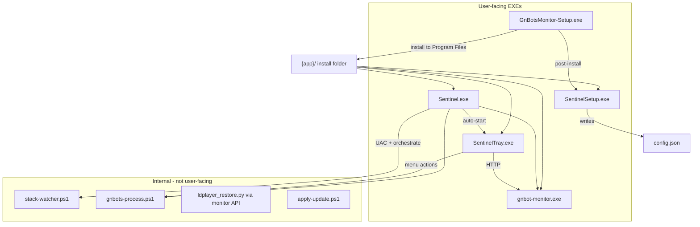

# Native EXE Release Plan

**Title:** Sentinel Native EXE Release (C# Launchers + Inno Installer)

Ship a frozen Windows release where end users run real `.exe` files — not batch files — for install, first-run setup, stack launch, and tray control.

---

## Current state

| Component | Status | Gap |
|-----------|--------|-----|
| `gnbot-monitor.exe` (PyInstaller) | Spec + `build.ps1` exist | Not the primary shipped artifact |
| `GnBotsMonitor-Setup.exe` (Inno) | `installer.iss` + `build-installer.ps1` exist | Not built in CI; shortcuts point to `.bat` |
| Source zip (`package-release.ps1`) | Ships `Sentinel-*.zip` | Requires Python/venv — dev-only |
| User entry points | `.bat` wrappers | Must become C# EXEs |
| Internal automation | PowerShell scripts | Stay internal; not user-facing |

---

## Target architecture



**Install folder layout (release):**

```
GnBotsMonitor-Release/
  Sentinel.exe              # Stack launcher (replaces StartGnBotStack.bat)
  SentinelSetup.exe         # First-run wizard (replaces Setup Wizard.bat)
  SentinelTray.exe          # System tray (replaces tray-app.ps1 entry)
  gnbot-monitor.exe         # Dashboard server (PyInstaller)
  _internal/                # Python runtime bundle
  static/
  scripts/                  # Internal PS automation only
  config.example.json
  version.json
  logs/
```

No `.bat` files in the release folder. Dev/source tree keeps bats for local development.

---

## C# solution structure

Create `monitor/native/Sentinel.sln` with four projects:

| Project | Output | Type |
|---------|--------|------|
| `Sentinel.Shared` | DLL | Class library — paths, config JSON, process helpers |
| `Sentinel.Launcher` | `Sentinel.exe` | WinExe — UAC + stack orchestration |
| `Sentinel.Setup` | `SentinelSetup.exe` | WinExe — WinForms setup wizard |
| `Sentinel.Tray` | `SentinelTray.exe` | WinExe — NotifyIcon + context menu |

**Shared library (`Sentinel.Shared`):**

- `InstallPaths.cs` — mirror `paths.py`: resolve install root from `AppContext.BaseDirectory`, honor `GNBOT_MONITOR_ROOT`
- `MonitorConfig.cs` — read/write `config.json` (subset: paths, ports, tray flags, `setup_complete`)
- `ProcessRunner.cs` — start hidden PowerShell with `-File`, start `gnbot-monitor.exe`, open URL
- `Elevation.cs` — detect admin, re-launch self with `runas` verb (same as `StartGnBotStack.bat`)
- `VersionInfo.cs` — read `VERSION` / `version.json` for About dialogs

**Target framework:** `net8.0-windows` (WinForms for Setup + Tray). Publish as `win-x64` self-contained **false** (framework-dependent) to keep size small — Windows 10+ has .NET 8 runtime or bundle it in installer `[Run]` check.

---

## Phase 1 — Frozen build as primary artifact

**Goal:** End users never need Python installed.

### Tasks

1. **Validate PyInstaller build locally**
   - Run `monitor/build/build.ps1`
   - Smoke: `gnbot-monitor.exe` serves `/api/ping` on configured port
   - Confirm `paths.py` frozen mode: config/logs beside EXE, static from `_internal`

2. **Update `build.ps1`**
   - Stop copying `Setup Wizard.bat` and `StartGnBotStack.bat` into release (after Phase 2)
   - Add icon + version resource step (Phase 4)

3. **Deprecate source zip as product**
   - Keep `package-release.ps1` for dev/git clones only; rename output to `Sentinel-Source-*.zip`
   - Update `README.md`, `RELEASE_PLAN.md`, `build/README-INSTALL.txt` to point at frozen zip + Setup.exe
   - CI: stop publishing source-style artifacts as primary

### Files

- [monitor/build/build.ps1](monitor/build/build.ps1)
- [monitor/scripts/package-release.ps1](monitor/scripts/package-release.ps1)
- [monitor/build/gnbot-monitor.spec](monitor/build/gnbot-monitor.spec) — add `icon=` in Phase 4

---

## Phase 2 — C# native launchers

### 2A — `Sentinel.Shared` + `Sentinel.Launcher` → `Sentinel.exe`

**Port from:** [monitor/scripts/start-gnbot-stack.ps1](monitor/scripts/start-gnbot-stack.ps1), [monitor/StartGnBotStack.bat](monitor/StartGnBotStack.bat)

**Responsibilities:**

1. If not elevated and GnBots requires admin → re-launch self with `Verb = "runas"` (UAC once)
2. Set `GNBOT_MONITOR_ROOT` to install directory
3. Stop stale watcher/launcher PIDs (port logic from PS1)
4. Start `scripts/stack-watcher.ps1` hidden via PowerShell
5. Ensure monitor healthy — start `gnbot-monitor.exe` if `/api/ping` fails (delegate to `scripts/start-stack.ps1` initially)
6. Wait for monitor health (poll `/api/ping`, 60s timeout)
7. Launch GnBots via `scripts/gnbots-process.ps1 -Action Start`
8. Auto-start `SentinelTray.exe` (replace `start-tray.ps1` call)
9. Log to `logs/stack-start.log`
10. Exit 0 on success; show MessageBox on fatal error (non-silent mode)

**App manifest:** `requireAdministrator` optional — prefer dynamic relaunch like current bat (only elevate when config requires it via `gnbots-elevation.ps1` logic; Shared can invoke that script for parity in v1).

**v1 strategy:** C# owns UAC + sequencing; delegate heavy lifting to existing PS scripts via `ProcessRunner`. Reduces regression risk. v2 can inline watcher/monitor spawn.

### 2B — `Sentinel.Setup` → `SentinelSetup.exe`

**Port from:** [monitor/scripts/setup-wizard.ps1](monitor/scripts/setup-wizard.ps1) (~290 lines, 7 steps)

**Wizard steps (match existing):**

1. Welcome
2. Install folder (read-only display)
3. GnBots.exe browse + auto-fill root
4. LDPlayer path (optional)
5. Backup folder (optional)
6. Shortcuts/tasks checkboxes (desktop shortcut → `Sentinel.exe`, logon watcher, elevated tasks)
7. Finish → write `config.json`, set `setup_complete: true`, optional `ensure-elevated-tasks.ps1` elevated, start stack via `Sentinel.exe`, open dashboard

**Validation:** GnBots.exe must exist on step 3; port-in-use warning on finish.

### 2C — `Sentinel.Tray` → `SentinelTray.exe`

**Port from:** [monitor/scripts/tray-app.ps1](monitor/scripts/tray-app.ps1) (~677 lines)

**Responsibilities:**

- Single-instance lock (`logs/tray.lock`)
- NotifyIcon with status-colored icon (green/yellow/red)
- Poll monitor `/api/ping` + GnBots health on interval from config
- Context menu:
  - Open dashboard
  - Restart stack → `restart-headless.ps1`
  - Stop monitor + watcher → `stop-monitor-stack.ps1`
  - Stop everything → stop all + exit tray
  - Launch / Close GnBots → `gnbots-process.ps1`
  - Run setup → launch `SentinelSetup.exe`
  - Check for updates → HTTP `POST /api/update/check` or open Settings
  - Exit
- Balloon notifications for setup incomplete, GnBots closed, etc.

**v1 strategy:** Port UI + polling in C#; invoke PS scripts for stack actions (same as current tray). Reuse icon PNGs from `static/icons/` converted to `.ico`.

### Files to create

```
monitor/native/
  Sentinel.sln
  Sentinel.Shared/
    Sentinel.Shared.csproj
    InstallPaths.cs
    MonitorConfig.cs
    ProcessRunner.cs
    Elevation.cs
  Sentinel.Launcher/
    Sentinel.Launcher.csproj
    Program.cs
    StackOrchestrator.cs
    app.manifest
  Sentinel.Setup/
    Sentinel.Setup.csproj
    SetupWizardForm.cs
    Program.cs
  Sentinel.Tray/
    Sentinel.Tray.csproj
    TrayApplicationContext.cs
    Program.cs
  Directory.Build.props          # version, nullable, langversion
```

### Files to update (references)

- [monitor/app.py](monitor/app.py) — `/api/setup/launch-wizard` → spawn `SentinelSetup.exe` instead of PS1
- [monitor/scripts/apply-update.ps1](monitor/scripts/apply-update.ps1) — restart via `Sentinel.exe`
- [monitor/static/index.html](monitor/static/index.html) — banner text references `SentinelSetup.exe`
- Dev bats (`StartGnBotStack.bat`, `Setup Wizard.bat`) — keep as thin dev wrappers calling C# EXEs when present, else PS1 fallback

---

## Phase 3 — Build integration

### Extend `build.ps1`

After PyInstaller step, add:

```powershell
# Publish C# launchers
dotnet publish monitor/native/Sentinel.Launcher -c Release -r win-x64 --self-contained false -o $launcherOut
dotnet publish monitor/native/Sentinel.Setup   -c Release -r win-x64 --self-contained false -o $launcherOut
dotnet publish monitor/native/Sentinel.Tray    -c Release -r win-x64 --self-contained false -o $launcherOut

Copy-Item "$launcherOut/Sentinel.exe"        $OutputDir
Copy-Item "$launcherOut/SentinelSetup.exe" $OutputDir
Copy-Item "$launcherOut/SentinelTray.exe"  $OutputDir
# Copy Sentinel.Shared.dll + runtime deps as needed
```

Add `build/build-native.ps1` wrapper for local iteration.

### PyInstaller spec

- Add `icon='build/sentinel.ico'` to EXE section
- Ensure `version.json` is written before build (`write-version.ps1` already runs)

### Icon asset

- Convert `static/icons/sentinel-logo.png` → `build/sentinel.ico` (multi-size: 16, 32, 48, 256)
- Apply to all four EXEs + Inno `[Setup] SetupIconFile`

---

## Phase 4 — Inno installer + CI

### Update `installer.iss`

| Setting | Old | New |
|---------|-----|-----|
| `MyAppExeName` | `StartGnBotStack.bat` | `Sentinel.exe` |
| `MyAppVersion` | hardcoded | pass via ISCC `/DAppVersion=...` from `VERSION` file |
| Post-install `[Run]` | `Setup Wizard.bat` | `SentinelSetup.exe` |
| Start menu shortcuts | `.bat` | `Sentinel.exe`, `SentinelSetup.exe` |
| Desktop icon | `StartGnBotStack.bat` | `Sentinel.exe` |

Add `[Run]` entry: copy `config.example.json` → `config.json` if missing (replaces `install-headless.ps1` for frozen installs).

**Upgrade / repair (shipped):** keep `DisableDirPage=no` and `AlwaysShowDirOnReadyPage=yes` so upgrades always show Select Destination Location (Inno `auto` would hide it). Prefill via `UsePreviousAppDir` + `SuggestedInstallDir` / `CurPageChanged`; detect existing installs with `IsSentinelInstallDir`; exclude `config.json` and `logs` from the copy; skip post-install wizard when `RepairInstall` is set. Operator runbook: `monitor/README.md` → Upgrade or repair. Contract test: `monitor/tests/test_installer_repair.py`.

`PrivilegesRequired=admin` may be needed if stack always requires elevation — evaluate against `gnbots-elevation.ps1` rules; default keep `lowest` and let `Sentinel.exe` UAC.

### Update `build-installer.ps1`

- Pass version: `& $iscc /DAppVersion=$version $iss`
- Fail if `Sentinel.exe` not in release folder

### Update `.github/workflows/release-monitor.yml`

Add steps after `build.ps1`:

1. **Setup .NET SDK** — `actions/setup-dotnet@v4` with `8.0.x`
2. **Build installer** — install Inno Setup 6 via `choco install innosetup` or `danielpalme/innosetup-action`
3. **Upload artifacts** — add `monitor/dist/GnBotsMonitor-Setup.exe`
4. **Publish release** — primary file: `GnBotsMonitor-Setup.exe`; secondary: `GnBotsMonitor.zip`

Tag releases (`v*`) publish non-prerelease with Setup.exe as the download users want.

---

## Phase 5 — Verification

### Automated

- Existing pytest (`test_paths`, `test_setup_status`) — unchanged
- Add `monitor/native/Sentinel.Shared.Tests` — config read/write, install path resolution
- CI smoke after build: start `gnbot-monitor.exe`, curl `/api/ping`, kill process

### Manual checklist (clean VM or temp folder)

| # | Scenario | Pass criteria |
|---|----------|---------------|
| 1 | Run `GnBotsMonitor-Setup.exe` | Installs to chosen dir, no Python required |
| 2 | Post-install wizard | `SentinelSetup.exe` runs, writes valid `config.json`, `setup_complete: true` |
| 3 | Desktop shortcut | `Sentinel.exe` starts stack, dashboard loads |
| 4 | Tray | `SentinelTray.exe` appears, status updates, menu actions work |
| 5 | No bats in install dir | Only `.exe` user entry points |
| 6 | Restore/provision | LDPlayer flows work (internal PS/Python still invoked by monitor) |
| 7 | Apply update | Settings → Apply preserves `config.json` + `logs/`, restarts via `Sentinel.exe` |
| 8 | Uninstall | Inno uninstall; optional preserve config/logs prompt works |
| 9 | Dev fallback | Git clone + `setup.bat` still works for developers |

---

## Deprecation matrix

| Artifact / entry | After plan |
|------------------|------------|
| `Sentinel-1.0.0-rc1.zip` (source) | Renamed/labeled dev-only |
| `GnBotsMonitor-Setup.exe` | **Primary user download** |
| `GnBotsMonitor.zip` (frozen) | Portable alternative |
| `Sentinel-Install.bat` | Dev only; frozen install uses Inno |
| `StartGnBotStack.bat` | Dev fallback wrapper |
| `Setup Wizard.bat` | Dev fallback wrapper |
| Web `/setup` | Fallback only; wizard is `SentinelSetup.exe` |

---

## Optional follow-up — code signing

Not required for personal use; required for broad distribution (SmartScreen).

1. Obtain Authenticode cert (OV/EV)
2. Sign order: `Sentinel.exe`, `SentinelSetup.exe`, `SentinelTray.exe`, `gnbot-monitor.exe`, then `GnBotsMonitor-Setup.exe` (SignTool or Inno `SignTool` directive)
3. Add CI secret `SIGNING_CERT_PFX` + timestamp server
4. Document in `build/SIGNING.md`

---

## Implementation order (recommended)

1. Validate PyInstaller build + fix any frozen-runtime issues
2. Scaffold `Sentinel.Shared` + `Sentinel.Launcher` (highest user impact)
3. Port `SentinelSetup.exe` (installer post-install depends on it)
4. Port `SentinelTray.exe`
5. Wire `build.ps1` + icons
6. Update Inno + CI
7. Manual VM verification
8. Deprecate source zip in docs/releases

**Estimated scope:** ~3 C# WinExe projects + shared lib; PS scripts remain internal orchestration layer for LDPlayer/GnBots/update complexity.
